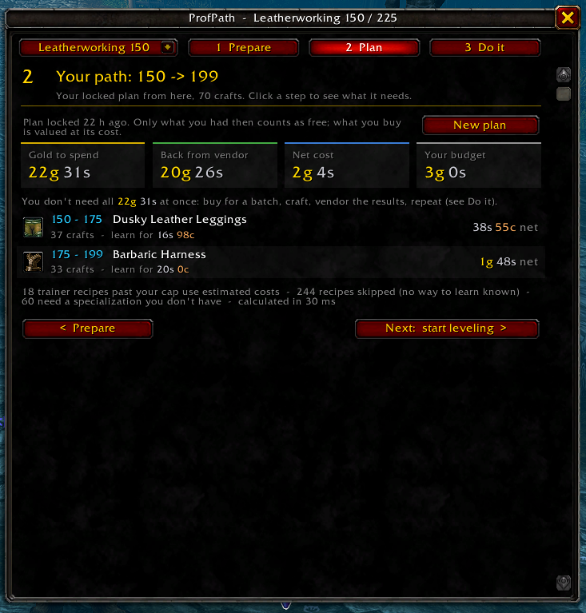
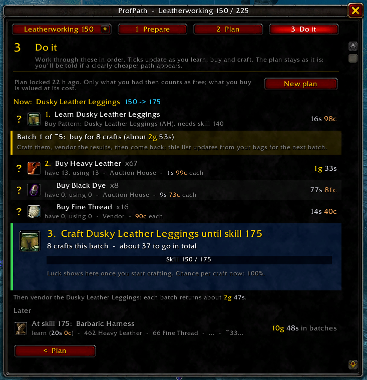

# ProfPath

**The cheapest way to level your professions in WoW: Forever, worked out from your realm's live auction prices.**

Download: [CurseForge](https://www.curseforge.com/wow/addons/profpath) (WoW: Forever).
Questions or feedback: [Discord](https://discord.com/users/120143105952317440) or [open an issue](https://github.com/inequitas/ProfPath/issues).

ProfPath looks at your character (known recipes, bags, gold) and your auction house, plans the cheapest
path from your current skill, and keeps re-checking it while you level. Type `/pp` in game or use the
minimap button: **Prepare → Plan → Do it**. Run `/pp help` for all commands.

  
  

## What's new

**[v0.2.0](https://github.com/inequitas/ProfPath/releases/tag/v0.2.0): Gathering routes, skinning, fishing and a smarter planner** *(2026-11-21)*

- **Gathering routes** for Mining, Herbalism and Skinning: where to go for your skill, and a compact
  loop on the world map and minimap that stays on walkable ground, goes around lakes and avoids enemy
  towns and dangerous camps. Closest zones (and ones with a known flight path) come first.
- **Skinning by level:** beasts that suit your skill and your character level, listed by name.
- **Hot spots and caves:** mines and dense clusters near a route; cave waypoints go to the entrance.
- **Fishing advice:** what to do at your skill, lures, and waypoints to Old Man Heming and Nat Pagle.
- **Smarter planner:** owned items only cover the units you have, batches stay fixed while you craft,
  and recalculating no longer freezes the game.
- **Crafting stations** are named, and **non-English game clients** are supported.

Earlier versions and full details: [CHANGELOG.md](CHANGELOG.md).

## Development

Requirements: Windows PowerShell, and [Lua 5.4](https://www.lua.org) for the offline tests.

| Task | Command (from this folder) |
|---|---|
| Rebuild recipe data for a new game build | `powershell -ExecutionPolicy Bypass -File tools\build_data.ps1 -Build <build>` |
| Run the optimizer tests | `lua tests/optimizer_spec.lua` |
| Run the simulated in-game test | `lua tests/wow_sim.lua` |
| Install into the game | `powershell -ExecutionPolicy Bypass -File tools\install.ps1` |
| Build the release zip (`dist\`) | `powershell -ExecutionPolicy Bypass -File tools\package.ps1` |
| Regenerate the icon | `powershell -ExecutionPolicy Bypass -File tools\make_icon.ps1` |

Layout: `Optimizer.lua` (pure Lua: planning, budget fitting, scan pruning), `Prices.lua` (auction prices,
scans), `Recipes.lua` (professions, recipes, trainers), `Capture.lua` (vendors, trainers), `Track.lua`
(live tracking), `UI.lua` (window), `Minimap.lua`, `Core.lua` (glue, slash commands), `Data/` (generated
data). Design notes are in `PLAN.md`.

To release: raise `## Version:` in `ProfPath.toc`, add the release to `CHANGELOG.md` and to "What's new"
above, run the tests, commit, then push a matching tag
(`git tag v0.1.1` and `git push origin v0.1.1`). The Release workflow (`.github/workflows/release.yml`,
BigWigs packager with `.pkgmeta`) builds the zip and uploads it to CurseForge for WoW Forever and to a GitHub
release. It needs the repository secret `CF_API_KEY` (a CurseForge API token).

## Credits

- Trainer, ore, herb and creature locations: [Wowhead](https://www.wowhead.com/forever).
- Recipe data and terrain: the game's data files via [wago.tools](https://wago.tools).
- Gathering zones follow the WoW: Forever guides on Wowhead and [wow-professions.com](https://www.wow-professions.com/forever).

## License

MIT, see [LICENSE.txt](LICENSE.txt).
